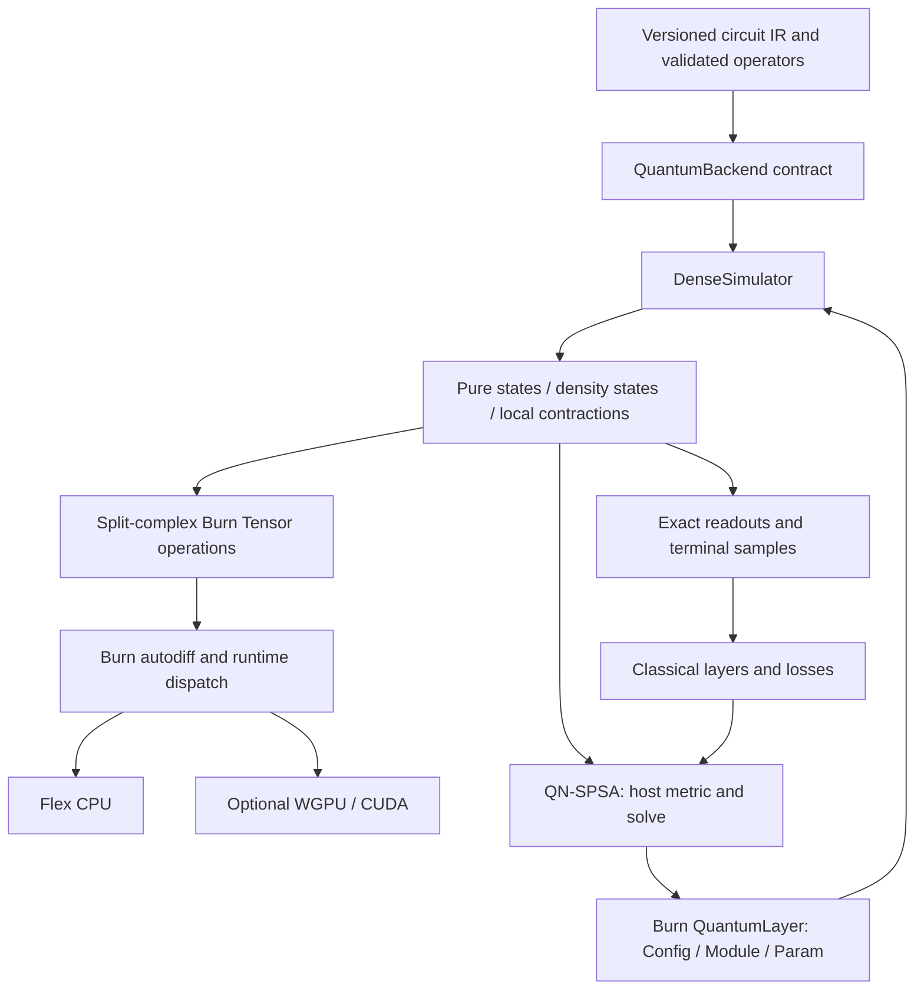

# burn_quantum architecture and implementation plan

See [repository organization](organization.md) for the current source-module map
and the distinction between public exports and private implementation files.
The dense-engine design below is the original architectural baseline. Current
[photonic engines and runtimes](photonic-status.md) and [MPS/distributed execution](tensor-network.md)
extend it with separate representation and control contracts.

## Scope and invariant

Build a finite-dimensional quantum execution layer for Burn 0.22.1, with a
correct differentiable reference implementation before specialized kernels.
Support qubits, qudits, mixed-radix registers, local operators, exact observables,
shot sampling, open-system evolution, and hybrid classical/quantum training.
Do not promise efficient classical simulation of arbitrary quantum programs.

Burn 0.22 uses `Tensor<D>`, `Device`, `Module`, and `Param<Tensor<D>>` without a
public backend type parameter. Its dispatch catalog currently cannot register
out-of-tree backends. Accordingly, `QuantumBackend` is an independent quantum
execution contract; `DenseSimulator` composes native tensor operations on any
enabled compatible Burn device. This is not a fabricated `burn::Backend` impl.
New fused primitives can later use Burn's `#[backend_extension]` routing with
explicit forward, autodiff, and fusion implementations.

The [Boolean SAT extension](sat.md) compiles reversible CNF oracles into reusable
structured `ControlledX` and `PhaseFlip` instructions. These use native tensor
gathers/sign multiplication with linear state-sized plans. `Circuit::run_from`
supports repeated execution on existing states without duplicating instruction
lists. Circuits using these instructions have schema v2; legacy-only circuits
retain v1 serialization. Readback remains explicit at terminal measurement.

Sources checked 2026-10-29:

- [Burn 0.22 migration](https://burn.dev/books/burn/migrating-to-0.22.html)
- [Backend extensions](https://burn.dev/books/burn/advanced/backend-extension/index.html)
- [Burn 0.22.1](https://docs.rs/burn/0.22.1/burn/)
- [General parameter-shift rules](https://arxiv.org/abs/2107.12390)
- [Universal finite-dimensional gates](https://arxiv.org/abs/quant-ph/0210049)

## Layers

1. Validated register, matrix, unitary, observable, and Kraus-channel types.
   Wire zero is most significant. Ordered targets define a local basis in the
   same convention. All size products use checked arithmetic.
2. A serializable circuit IR separates structure from parameter bindings and
   input data. An affine angle can reference a shared trainable parameter or
   a per-example input feature. Unknown wire dimensions, malformed matrices,
   and invalid bindings fail before tensor execution.
3. Split real/imaginary Burn tensors represent complex states and operators.
   Both components have identical shape, floating dtype, and hardware device.
   F32 and F64 are supported where the selected tensor backend supports them.
4. A dense engine applies local operators by packing selected axes into a
   local index, contracting a small matrix, and undoing the permutation. No
   full-register matrix is built for local gates. State batches and gate
   batches use explicit broadcasting rules.
5. State-vector and density-matrix APIs expose exact probabilities,
   expectations, reduced states, channels, and terminal computational-basis
   samples. Sampling and host-side validation are explicit readback boundaries.
6. `QuantumLayer` owns ordinary Burn parameters and returns ordinary tensors.
   Existing optimizers and classical modules can train through the complete
   differentiable simulator without custom gradient bridges.
7. `qml` composes the circuit/state APIs into reusable feature embeddings,
   circuit layers, readout conversions, probability losses and fidelity kernels.
   The `burn_quantum_example` workspace crate holds application-specific models,
   datasets and evaluation, with each algorithm in one executable source file.
   State-based objectives use `QuantumLayer::state`; configured Hermitian
   readouts use `forward`.
8. `optim` provides evaluation-based quantum natural SPSA using ordinary Burn
   parameter tensors and scalar loss/fidelity callbacks. Quantum evaluations
   use the caller's device; the running Fubini–Study metric and regularized solve
   use host F64. This explicit synchronization boundary avoids misrepresenting
   a fresh-evaluation optimizer as a consumer of backpropagated gradients.
   `Param::map` preserves model identity and weight-record structure. See the
   [QN-SPSA design and validation](qnspsa.md) for schedules, checkpoint semantics,
   constant evaluator counts, and dense classical scaling limits.

## Numerical contracts

Constant unitary and Hermitian matrices are validated on the host; constructors
never silently normalize an invalid operator. State import checks shape and
offers an explicit physical-state validation step, since a synchronous readback
inside every differentiable operation would harm device execution. Rotations
are constructed analytically. No amplitudes or trainable values are read back
during dense unitary circuit execution. No silent float-to-complex reinterpretation occurs.

Quantum matrix products use native Flex GEMM on CPU and explicit multiply/reduce
contractions on other devices. The locked CubeCL 0.11.3 accelerator path can
convert F32 operands to TF32, which exceeded quantum normalization/gradient
tolerances during CUDA qualification. The portable replacement retains native
Burn autodiff and fusion, evaluates one output column at a time, and bounds each
product by the existing input/state allocation budget. It avoids a four-axis
broadcast temporary, at the cost of additional kernel launches and retained
autodiff intermediates. Full-precision specialized GPU kernels can replace it
after passing the same regression suite; no tolerances were relaxed in that suite.

General qudit rotations act on a selected pair of levels. Their generator has
an additional zero eigenvalue when dimension exceeds two. Consequently, the
qubit two-term parameter-shift rule must not be used indiscriminately. The
implementation shifts each gate occurrence independently, applies its
affine chain-rule factor, and uses a four-term recipe for embedded two-level
rotations. Simulator reverse-mode differentiation remains the default.

## Implementation sequence

- P0: establish current Burn compatibility, contracts, typed validation and
  resource limits; build independent scalar-reference test helpers.
- P1: implement mixed-radix state-vector contraction, complex gates, controls,
  exact measurement, batching, and normalization tests.
- P2: add symbolic circuits, input/parameter binding, serializable versioned
  specifications, occurrence-wise parameter-shift, and native Burn modules.
- P3: add density matrices, local Kraus channels, reduced states, and analytic
  noise tests; preserve state-vector memory independence.
- P4: demonstrate CPU hybrid training, optional GPU execution, gradient
  agreement, resource rejection, documentation, reproducible profiling and CI.

## Scale and future engines

For batch B, Hilbert dimension N = product(d_i), and local gate dimension K,
state storage is 2BN real scalars and local contraction costs O(BNK). The current
uncached mixed-radix planner additionally costs O(Nm) for m register wires.
Local operator storage is O(K²); gather plans cost O(N) indices per distinct
target layout. Density storage is 2BN² scalars. Reverse-mode graph retention
adds a depth-dependent cost beyond these forward allocations. The resource
limits are preflight element budgets, not a guarantee against device OOM.

Alternate engines report their own representation and capabilities. The current
checkout implements [MPS and distributed MPS](tensor-network.md),
[Clifford tableaus and frames](photonic-stabilizer.md),
[bounded Fock optics](photonic-optics.md), and local noisy trajectories. Sparse
state engines and distributed dense state vectors remain separate extensions.
None removes worst-case exponential complexity. Compilation, connectivity,
precision, error tolerances and shot budgets belong to an execution plan.

The dense path accepts arbitrary finite local unitary matrices, so new
finite-dimensional gates are expressible without changing the engine.
Arbitrary future applications cannot be guaranteed. Continuous-variable models
need justified finite cutoffs; the optical module exposes convergence diagnostics.
Measurement patterns and causal event programs implement explicit classical
control, while the unitary `Circuit` stays a separate straight-line IR.
The [local job runtime](photonic-runtime.md) retains asynchronous status,
provenance and calibration contracts. Hardware-provider execution and its
noise/shot-aware differentiation still require separate qualification.

## Qualification gates

Analytic Bell/GHZ and qudit states; mixed-radix/endian and nonadjacent/reversed
targets against an independent scalar implementation; complex phase-sensitive
checks; unitary inverse/norm preservation; mixed-state trace/Hermiticity and
known channels; reduced entanglement; batch isolation; trainable and input
gradients against finite differences and parameter shifts; shared parameters;
actual loss reduction through Burn optimizer; serialization rejects malformed
invariants; overflow and allocation budgets fail early. CPU qualification is
separate from optional GPU forward/backward numerical parity and performance.
