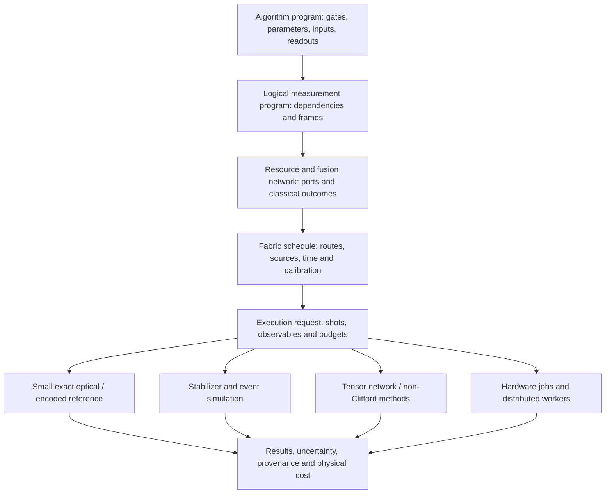

# Photonic / FBQC architecture and staged implementation plan

See the [current acceptance map and extension boundaries](photonic-status.md)
for the subsequent M1–M7 local-simulation work and PsiQuantum direction. The
capability inventory and proposed steps below preserve the original M0 planning
baseline; they are not the current list of unimplemented features.

Recorded 2026-11-09 against the virtual workspace at `3b44738`. The
[foundation guide](photonic-fbqc.md) defines what this change implements.
Everything labeled **proposed** below is a future deliverable, not a hidden
backend capability or an empty feature flag. The objective is a useful stack
for designing, compiling, simulating and eventually executing photonic QML,
with explicit correctness, resource and uncertainty contracts.

## Architectural decision

Keep five distinct representations with checked lowering between them:



Today the resource-program-to-static-fabric path is executable, as is the
separate local-qubit-circuit-to-dual-rail encoding pass. The first two full
lowerings in the diagram remain to be built. An encoded qubit operation, a
bosonic mode operation, and a scheduled physical device action are not aliases.

The current `QuantumBackend` is a synchronous analytic circuit interface whose
readouts include a full probability tensor. Preserve it for existing users.
Large photonic jobs need selective readouts and shot/result streams, not a
requirement to materialize all amplitudes. Develop a separate execution
contract only after both a second simulator and a hardware/mock-job adapter
exercise it. Avoid freezing a speculative universal backend trait now.

The initial implementation stays in `burn_quantum::photonic`, reusing Burn
`Tensor<D>`, `Device`, `ComplexTensor`, density channels, resource guards and
precision handling. It adds no dependency. Split optional implementation crates
when their dependencies or deployment needs justify it: a stabilizer engine,
a Fock engine, provider/Perceval interoperability, and distributed orchestration
are candidates. Public mathematical IR should not depend on a Python runtime,
a network provider, a decoder package, or a particular accelerator.

Perceval separates photonic components, experiment configuration and multiple
simulation strategies. Its treatment of time delays, loss and retained physical
performance is useful inspiration; API compatibility and numerical equivalence
must be demonstrated rather than inferred from a similar class name.
[Perceval paper](https://arxiv.org/abs/2204.00602),
[nonunitary experiment tutorial](https://perceval.quandela.net/docs/v1.3/notebooks/Simulation_non-unitary_components.html).

## Capability inventory and completion criteria

| Area | Implemented foundation | Required for broader completion |
| --- | --- | --- |
| Encoding | One dual-rail photon or vacuum per site | Named spatial/temporal/polarization modes; multiphoton leakage; code-space extraction |
| Sources | Ideal supplied graph, Bell and six-ring states | Heralded factories, brightness, multiphoton contamination, correlations, emission-time distributions |
| Passive optics | Local `U ⊕ 1` encoding only | Beamsplitters, phases, permutations, meshes, delays, mode overlap; validated Fock lifting |
| Loss | Independent rail attenuation, storage and detector attenuation | Correlated/path-dependent loss, phase noise, uncertainty and calibration models |
| Detection | Ideal PNR within the specified fusion instrument | Finite PNR resolution, threshold detection, dark counts, dead time, saturation and false heralds |
| Fusion | Fixed unboosted analyzer, partial parity, destructive branch state | Alternate failure bases, boosted/encoded instruments, calibrated outcome maps |
| Resources | Validated small graph descriptions and dense preparation | Preparation provenance, factory yield/cost, multiplexing and temporal availability |
| Algorithms | Local gate frontend plus resource-level programs | Entangling gadget library, adaptive measurements, logical gates, non-Clifford resources |
| Fabric | Directed packet routes, exclusive links, static serial fusions | Finite buffers, switch configuration, concurrent scheduling, rail skew, controller latency |
| Simulation | Dense encoded density reference with complete branches | Stabilizer/Pauli frames, trajectories, Fock sectors, tensor networks, selective readouts |
| Error correction | Outcomes retain erased vs known parity | Checks, logical observables, detector models, decoders, failure-rate studies |
| Learning | Input gradients through encoding/loss/branch weights | Trainable optical parameters, stochastic estimators, physical-cost objectives and noisy geometry |
| Distribution | Device-independent immutable compilation | Shot sharding, causal windows, distributed state ownership, cancellation and replay |
| Hardware | None | Provider capabilities, calibrated compilation, authentication, asynchronous jobs and audited results |

No milestone is complete merely because its structs serialize or its code
compiles. Every row needs a numerical/physical oracle, an invalid-input suite,
resource limits, documented approximations and an executable example.

## Module ownership

The implemented layout is:

```text
crates/burn_quantum/src/photonic/
  mod.rs                    Public namespaces and concise exports
  encoding.rs               Code/vacuum convention and restricted Circuit lowering
  loss.rs                   Checked transmission and quantum loss channel
  resource.rs               Ideal small resource descriptions and preparation
  fusion.rs                 Instrument, records, subnormalized branches
  fabric/
    mod.rs                  Validated topology and physical assumptions
    routing.rs              Timed routes and exclusive reservations
  program/
    mod.rs                  Friendly builder, stable IDs, validated source schema
    compiler.rs             Static schedule, attenuation and plan provenance
  simulator/
    mod.rs                  Dense execution and branch budgets
    sampling.rs             Explicit host readback and unconditional attempts
```

Proposed additions have distinct responsibilities: `optics/` for mode/Fock
semantics, `instruments/` when more than one physical analyzer is supported,
`compiler/` for logical and measurement passes, `factories/` for source and
multiplexing programs, `qec/` for syndrome/logical structures, and `runtime/`
for jobs/events. Create these with working implementations, not empty facades.
Keep backend-specific kernels and interop in optional sibling crates when needed.

Shared readout conversions, branch-weighted losses, encodings and estimator
contracts belong in the core. Application datasets, ansatz choices, training
loops and acceptance criteria remain one file per example in
`burn_quantum_example/src/bin/`. Host environment/device selection stays in
executable support, not the public library.

## Milestone 0: executable reference and semantic baseline

**Delivered in this change:** explicit vacuum, asymmetric loss, graph resources,
complete destructive fusion, partial parity, local frontend, resource compiler,
routing with contention/storage attenuation, exact branches and seeded sampling.
`fbqc_bell_swap` demonstrates the entire implemented resource-to-fabric path.
The validation record covers physical scalar oracles and actual CPU/GPU execution.

Retain this engine as the correctness oracle. Its dense state costs `2 B 9^n`
real scalars and its explicit record enumeration grows as `5^F`. Raising those
limits or adding more GPUs is not the primary FBQC scaling strategy.

## Milestone 1: scalable Clifford/resource execution

This is the recommended next execution engine for large FBQC studies.

1. Implement a stabilizer tableau or graph-state-plus-local-Clifford representation
   with stable photon IDs, destructive one/two-qubit measurements and Pauli frames.
2. Represent vacuum/loss and erasure metadata explicitly. Derive mixed-state or
   trajectory updates from tracing a lost entangled photon; deleting a vertex
   without its conditional/neighbour effect is not generally correct.
3. Preserve joint XX/ZZ records and their correlation within a fusion. Preserve
   known failure parities. Do not generate independent random parity bits for
   erased measurements or infer certainty from a missing detector click.
4. Separate a reference-state evolution from batched error/Pauli-frame sampling
   when its noise assumptions permit it. Stim illustrates the effectiveness of
   this strategy for stabilizer workloads; its reported performance is not a
   performance claim for this repository. [Stim paper](https://arxiv.org/abs/2103.02202).
5. Add selective Pauli expectations, sampled logical readouts and instrument
   records. Full distributions should require an explicit small-output budget.

Initially restrict this engine to balanced rail erasure and supported Clifford/
Pauli noise models. Unequal rail transmission applies a state-dependent
nonunitary filter even in the no-loss branch and generally leaves the stabilizer
family. Reject that model or route it to a suitable dense/tensor-network engine;
do not silently replace it by scalar loss. Any approximation needs an explicit
error contract and dense comparison.

Acceptance: exhaustively compare small resource/fusion patterns against the
dense instrument, including nonadjacent/reversed operands, failure branches,
loss and known byproducts. Cross-check independent Clifford fixtures with Stim
or another maintained reference under pinned versions. Show polynomial memory
on increasing Clifford lattices; measure setup, sampling and decoding separately.
Reject unsupported non-Clifford inputs explicitly.

## Milestone 2: optical physics and calibrated instruments

Develop this in parallel with milestone 1; it supplies trustworthy small-device
models for the scalable engine.

- Define typed mode IDs and mappings for dual-rail sites. Distinguish spatial
  modes, time bins and internal wavepackets. A classical transport link must not
  be mistaken for a coherent optical interferometer.
- Start with fixed-total-photon Fock sectors: m modes and n photons have
  `binomial(m+n-1,n)` basis states. Supporting totals 0..N needs
  `binomial(m+N,N)` states. Enforce checked combinatorics before enumeration.
- Implement explicit phase/beamsplitter conventions, mode permutations and
  normalized bosonic amplitudes, including factorial occupation factors.
  Retain vacuum and loss sectors. A naive per-mode cutoff can make a truncated
  beamsplitter nonunitary at its boundary; require cutoff/leakage diagnostics.
- Add source mixtures, distinguishability and detection models with clear
  independence assumptions. Separate physical generation probability,
  herald probability and logical acceptance probability in results.
- Derive every fusion instrument from an optical recipe plus a detector model,
  or mark it as an effective model with calibration provenance. For boosted
  fusions account for additional ancilla photons, their preparation and their
  loss; a larger ideal success number alone is not a physical model.

Acceptance: Hong-Ou-Mandel interference, single-photon interferometers,
number conservation, unitary inverses, vacuum invariance, binomial loss,
coherence under rail asymmetry and detector edge cases. Export small golden
fixtures to pinned Perceval and compare both raw probabilities and heralded
performance with explicit mode/phase conventions. No Perceval runtime parity
has been established by the current foundation tests.

## Milestone 3: algorithm-to-FBQC compilation

Introduce a semantic logical program above `FusionProgram`. Reuse existing
`Circuit`/`Angle` input where valid; do not expand the current unitary enum into
an unstructured mix of hardware actions and control flow.

Required passes and preserved information:

| Pass | Required output and proof obligation |
| --- | --- |
| Validate/normalize | Supported gates, dimensions, symbolic parameter IDs, input/readout ordering, source locations |
| Decompose | Named native gate set, explicit approximation tolerance and accumulated synthesis error |
| Build measurement pattern | Entanglement pattern, measurement angles, classical dependency DAG, correction rules |
| Check determinism/causality | Flow or equivalent certificates where applicable; reject unresolved feedback dependencies |
| Select resources and fusions | Validated gadget library, consumed ports, open outputs, success/failure/loss semantics |
| Track frames | Logical observables and Pauli/Clifford corrections tied to actual classical outcomes |
| Place/schedule | Source factories, route/switch/buffer constraints, feed-forward deadlines and resource estimates |
| Lower to executor | Capability checks, numerical/noise model, shot budgets, parameter bindings and provenance |

Begin with independently verified teleportation, Bell distribution, CZ/CNOT
and Clifford gadgets. Add arbitrary rotations through measurement angles or
specified non-Clifford resources, including the dependent corrections. For a
new gadget, compare its conditional quantum channel/Choi operator on a complete
input basis, with an entangled reference, for every nonzero branch. Testing
only `|00>` or only a successful branch is insufficient.

Measurement-pattern rewriting and dependency tracking have established formal
foundations. The plan is to use those correctness ideas, not claim that an
arbitrary ZX rewrite automatically provides a schedulable optical realization.
[Measurement calculus](https://arxiv.org/abs/quant-ph/0412135),
[unifying fault-tolerance models](https://arxiv.org/abs/2303.08829).

An additional relevant direction is typed synchronous dataflow for mixed qubit,
optical and classical control. Investigate it for verified feed-forward and
bounded repeat-until-success transformations after the base gadgets are proven.
[Photonic dataflow framework](https://arxiv.org/abs/2601.08389).

Acceptance: compiled local and entangling examples agree with native Burn dense
circuits within an explicit error budget; all parameter occurrences and readout
maps survive lowering; branch corrections are correct; failed compilation is
atomic and reports the unsupported instruction/gadget. A VQE/QAOA frontend is
accepted only when its entanglers, measurements and full physical cost actually
pass through this pipeline.

## Milestone 4: factories, realistic fabric control and adaptivity

Replace the initial static assumptions incrementally, using the same physical
record vocabulary and independently validated instruments.

- Model factories as heralded resource-producing programs with distributions
  over availability time, output quality and consumed photons. Separate missing
  resources from resources that were emitted and then lost. Include correlated
  defects shared by a source, interferometer or resource block.
- Add explicit capacities for source ports, switches, links, detectors and
  storage buffers. Distinguish whole-packet routes from independently routed
  rails, wavelength channels and time bins. Model rail skew, switch settings,
  reset/reconfiguration, detector dead time and classical feed-forward latency.
- Introduce partial-order scheduling and concurrent fusions with bounded
  reservations. Optimize throughput, survival or cost as explicit policies;
  expose the objective and report infeasibility rather than altering the model.
- Add typed classical dependencies and bounded loops for retry/multiplexing.
  A destructive failure cannot reuse consumed photons. Retries must acquire
  fresh resources and account for waiting loss on any surviving information.
- Run discrete-event trajectories for actual availability and control decisions.
  Each transition records its causal inputs, component calibration, random draw
  identity and output event. Reproduce a deterministic trace from a saved recipe.

Acceptance: adversarial shared-link/switch/buffer schedules never overlap
exclusive reservations; no photon arrives before it is created or after it was
consumed; a detector result reaches a controller before dependent operations;
loss is charged exactly once to every physical segment. Compare tiny stochastic
factories to exact enumeration. Report success per attempt, source yield,
resource occupancy, latency distributions and useful output rate separately.

## Milestone 5: QEC, logical observables and fault-tolerant workloads

The foundation's six-ring resource is not itself an error-corrected computer.
Building logical FBQC requires a fusion network, checks, boundary conditions,
logical observables, decoding and a specified noise model.

1. Represent resource stabilizers, intended fusion measurements, check relations
   and logical correlation surfaces independently of routing. Compile these
   relationships into the scheduled record indices and preserve their signs.
2. Add reference four-star/six-ring network generators, finite boundaries and
   encoded-fusion variants. State which physical qubits, ancillas and loss
   opportunities belong to each resource/fusion.
3. Generate erasure-aware detector/check models with correlated error events.
   Do not replace a joint fusion loss by unrelated per-parity erasure samples.
4. Define a decoder interface that consumes immutable syndrome/erasure data and
   returns a correction/frame, status and confidence/diagnostics where justified.
   Keep provider-specific decoder dependencies outside the mathematical IR.
5. Validate logical memory before gates, then lattice operations, injection and
   distillation. Include circuit/fabric-induced correlations and controller
   timing when moving from ideal code experiments to hardware estimates.

Acceptance: independent stabilizer checks and small-code enumeration, fault
injection at every declared location, known logical representatives, and
Monte Carlo curves at multiple distances with confidence intervals. Reproduce
published benchmark assumptions before comparing thresholds. A threshold from
a particular boosted/encoded network is not a generic per-photon budget for
all photonic hardware. Report simulation seeds, stopping rules and all modeled
loss sites; never advertise a threshold from a successful Bell-pair example.

## Milestone 6: photonic Quantum AI/ML

Keep learning semantics explicit as execution moves from exact tensors to
probabilistic instruments and physical hardware.

- Introduce parameterized optical components and parameterized measurement
  patterns with native Burn bindings. Cache static compilation separately from
  per-step tensors; never reuse a stale autodiff graph or stale calibration.
- Provide readouts that distinguish unconditional expectations, conditional
  expectations, herald probability, logical output validity and physical cost.
  Any conditional objective must expose its denominator and zero-success policy.
- For branch-weighted objectives, differentiate both branch probabilities and
  within-branch values. Reject implicit differentiation through a sampled route,
  click or rejection loop. Exact differentiation, parameter-shift jobs, score
  estimators and SPSA need separate capability/variance declarations.
- Extend QN-SPSA only with a specified metric and fidelity/overlap protocol for
  the actual state family. Pure-state Fubini–Study, mixed-state/Bures geometry,
  classical measurement Fisher information and a postselected-state metric are
  different choices. Include the physical cost of overlap estimation and any
  ancillary resources; constant evaluator count does not imply constant work.
- Add minibatched quantum evaluation and shot-allocation policies. Specify
  independence/common-random-number assumptions for optimizer probes and retain
  provider shot limits, completed counts, latency and uncertainty in records.
- Add application examples only after the corresponding compilation/runtime
  path exists: lossy photonic classification, optical kernels, a Born model,
  resource-aware VQE/QAOA, and an FBQC logical-memory/control task. Keep each
  algorithm in one executable source file with independent acceptance checks.

Acceptance: gradients against analytic and finite-difference oracles; exact
small-noise density references against finite-shot estimators; learning curves
across seeds; held-out datasets; matched classical/frozen/random-feature
controls; accuracy versus photons, accepted samples, latency and energy/cost
proxies. Do not infer large-model trainability or quantum advantage from a small
simulation's loss reduction. Trainable source/detector uncertainty needs held-out
calibration data and identifiability analysis, not just more free parameters.

## Milestone 7: scale-out execution and hardware jobs

Start with **independent shot/trajectory sharding**. It has a much cleaner
ownership boundary than distributing one dense state. Then add causal-window
partitioning of suitable stabilizer/event workloads. Distributed exact tensors
are a separate backend with explicit entanglement and communication costs.

Proposed execution requests should specify:

| Contract | Required content |
| --- | --- |
| Identity | Program, compiler, physical model and calibration fingerprints; semantic schema versions |
| Request | Parameter bindings, readout specification, total attempted shots, precision and error budgets |
| Placement | Backend capabilities, devices/workers, supported instruments, topology/window limits |
| Randomness | Global seed plus stable shot/component/event IDs; no dependence on thread scheduling |
| Limits | State/branch/event/queue budgets, timeout, retries and cancellation policy |
| Result | Completed/failed/incomplete attempts, raw and accepted counts, uncertainty, physical cost and provenance |

Use deterministic per-shot/per-component random streams, with an explicitly
versioned derivation scheme. Retrying a lost worker must not duplicate accepted
shots or silently sample a different experiment. Repartitioning should preserve
sample identities; floating arithmetic differences must be recorded separately
from stochastic replay. Checkpoint the event frontier, frames, pending classical
messages, source queues and random-stream positions, not just model weights.

For streaming windows, prove the causal cut and preserve pending feed-forward,
logical correlations and decoder boundary state. Do not discard entangled modes
merely because their nominal time bin expired. Use bounded queues, backpressure,
watermarks and measured tail latency. A queue filling or a missed physical
feedback deadline is an explicit failure mode.

Hardware adapters need asynchronous submit/status/result/cancel operations,
immutable jobs, capability negotiation, calibration expiry, authentication,
provider limits and raw detector/outcome provenance. Separate simulator fallback
from hardware execution through an explicit user-selected policy. Do not label
hardware results as differentiable Burn tensors. Perceval's newer runtime
separates experiment descriptions from local/remote computers; keep any adapter
versioned and optional. [Perceval runtime](https://perceval.quandela.net/docs/v1.3/reference/runtime/computer.html).

Acceptance: one-worker versus many-worker replay, disjoint shot accounting,
restart/cancellation/timeout tests, calibration mismatch rejection, bounded
memory under backpressure, and measured communication/serialization overhead.
Qualify hardware only through actual executions and raw results, not feature
compilation or a provider mock.

## API and persistence rules

- Keep logical qubits, physical photons, optical modes, resource ports,
  component IDs, time ticks, measurement bits and shot IDs as distinct types.
  The initial `PhotonId` is program-local; it is not a globally unique hardware
  identity. Add explicit program/epoch identity at distributed boundaries.
- Constructors and deserializers share invariant checks. Validate graph and
  instruction references before tensor/device work. Validate capabilities and
  budgets before executing or submitting a job.
- Version source IR, fabric/calibration schemas, compiler plans and result
  records independently. Include migration fixtures and reject unknown
  executable semantics. Canonical serialization/fingerprints need their own
  specification before caches rely on them.
- Keep device/dtype and batch validation native to Burn; preserve `Config`,
  `Module`, `Param` and record semantics for trainable modules. Classical
  scheduling objects need no backend type parameter.
- Add new physical instruments/readout types through non-exhaustive tagged
  vocabularies and tested capability negotiation. Stabilize builder/config
  methods before promising long-lived struct layouts. Do not promise that one
  API will represent every future continuous-variable or non-Clifford model.
- Gate optional engines/providers by meaningful features. The existing Cargo
  `fusion` flag is reserved for Burn kernel fusion. Avoid placeholder feature
  names that compile without implementing their advertised semantics.
- Keep opaque hardware failures, zero physical success and exhausted simulation
  budgets as distinct errors/results. A missing logical answer is not an
  all-zero output and must not be silently imputed into training data.

## Validation and performance gates

Maintain four complementary layers:

1. **Mathematical:** independent scalar-complex amplitudes/instruments,
   completeness/trace/positivity, noncommuting phases, code/vacuum separation,
   derivatives, branch normalization and logical-gadget channel equivalence.
2. **Compiler/runtime:** typed references, atomic failure, consuming lifetimes,
   schema fixtures, deterministic schedules, deadline/capacity checks,
   calibration provenance, model capability rejection and resource preflights.
3. **Cross-engine:** dense versus stabilizer versus optical small cases, pinned
   Perceval/Stim fixtures, finite-shot confidence intervals and cutoff convergence.
4. **Systems:** actual Flex/WGPU/CUDA execution with fusion off/on, precision
   parity, package-consumer checks, streaming/restart tests and real hardware
   validation when an adapter is implemented.

Benchmark separately: compilation time, resident graph/event state, dense or
Fock dimension, active photonic window, peak host/device memory, preparation
cost, loss by component, attempted and useful logical samples per second,
Pauli-frame and decoder throughput, p50/p95/p99 latency, synchronization,
communication and end-to-end optimizer step cost. Warm up and synchronize
accelerators; distinguish kernel throughput from useful computation.

Recommended dependency order:

```text
M0 foundations
  -> M1 stabilizer/resource execution -> M5 logical QEC studies
  -> M2 optical instruments -----------> calibrated M1/M5 models
  -> M3 verified algorithm lowering ---> M6 photonic QML
  -> M4 factories/adaptive scheduling -> realistic M3/M5/M6 workloads
M1 + M4 + explicit result contracts ---> M7 distributed/hardware execution
```

The immediate next implementation should be the Clifford resource executor and
its dense-parity suite, while small optical/Perceval fixtures establish device
conventions. Universal logical compilation, realistic factories and QEC should
advance through verified milestones before claims about large-scale photonic
AI. This sequence preserves a useful reference engine without making its
exponential state representation the architecture for the entire project.
