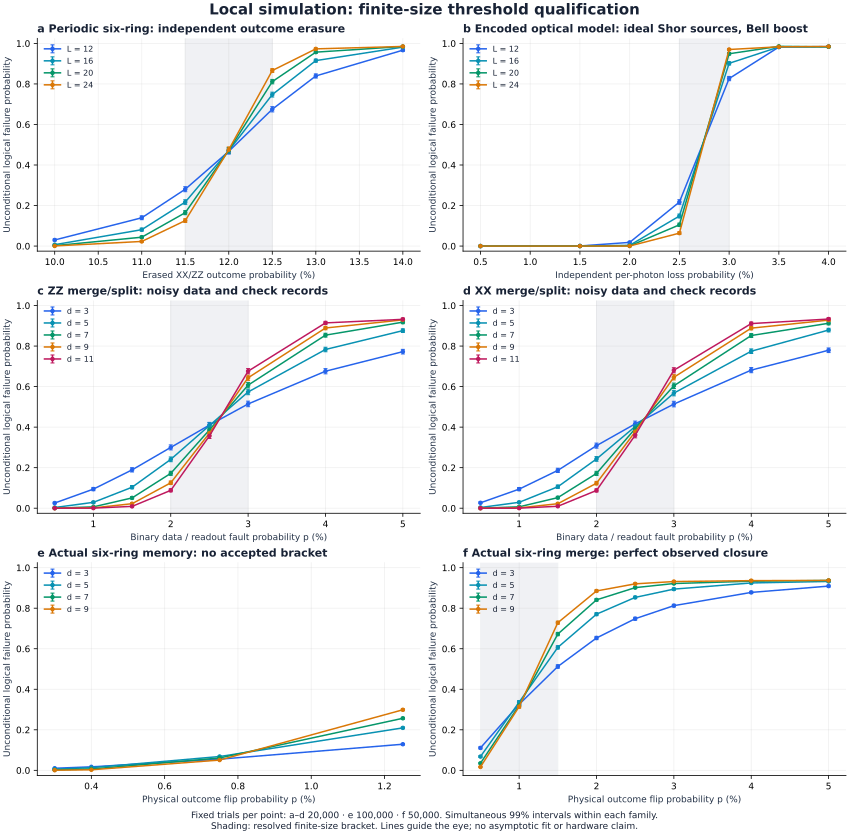

# Growing-distance surgery qualification

This record qualifies local simulation and explicit noise models. The source
manifest, raw cell counts, fixed protocols, independent-reference hashes and
runtime results are in [photonic-surgery-results.json](photonic-surgery-results.json).
The workspace base commit is recorded separately from the tested working-tree
hashes; this document does not claim a release or a remote CI result.

## What is now implemented

- Local planar XX/ZZ merge and split, measurement-only logical CNOT, actual
  entangled-input channels, distance witnesses, transition detectors and physical
  recovery from observed records. Distances grow through `d=11` in the noisy
  transition model, including the reported parity and all four Choi correlations.
- Actual color-preserving six-ring surface memories and fusion-seam merges.
  Independent signed channel fixtures and local resource-derived detector checks
  connect the quantum network to a sparse decoder. Both memory logical distances
  and all four merge record distances equal `d` for `d=3,5,7,9`.
- Exact erasure homology, bounded synchronous union-find growth, fixed-shot
  simulation and simultaneous exact binomial intervals. Every unsuccessful
  decoding attempt remains in the denominator.

The [architecture and model guide](photonic-surgery.md) and
[physical six-ring guide](photonic-fusion-surgery.md) describe the APIs and
assumptions. Native Burn tensor oracles execute on the selected device; tableaux,
graph decoding and Monte Carlo control execute on the host.

## Numerical studies

Every cell has a fixed sample size and deterministic seed/shot range. A direction
is accepted only when the simultaneous confidence intervals are disjoint at
**every adjacent tested size**. No scaling fit, asymptotic extrapolation or
optional stopping is used.

| Model | Tested sizes | Attempts | Resolved finite-size bracket |
| --- | --- | ---: | --- |
| Periodic six-ring independent outcome erasure | L12,16,20,24 | 560,000 | 11.5–12.5% outcome erasure |
| Ideal Shor sources, Bell-boosted correlated fusion loss | L12,16,20,24 | 560,000 | 2.5–3.0% independent photon loss |
| Planar noisy-check memory, initial study | d3,5,7,9,11 | 800,000 | Unresolved; retained without pooling |
| Planar noisy-check memory, independent confirmation | d3,5,7,9,11 | 4,000,000 | 2.0–3.0% per binary fault |
| Complete planar XX/ZZ merge/split | d3,5,7,9,11 | 1,600,000 | 2.0–3.0% for both parity instruments |
| Direct six-ring memory and fusion-seam merge | d3,5,7,9 | 3,200,000 | Merge: 0.5–1.5% physical outcome flips; memory unresolved |
| Direct six-ring memory, independent confirmation | d3,5,7,9 | 1,600,000 | No accepted bracket: intermediate finite-size trend is non-monotone |

The first three studies share one predeclared 96-interval family. The confirmation
has a fresh seed and a separate 40-interval family; its 100,000 trials per cell
are not pooled with the initial 20,000-trial study. The two surgery bases share
an 80-interval family. Each family has simultaneous 99% coverage; this is not
a claim of 99% coverage across the union of separately declared families.
The direct six-ring sweep has its own 64-interval family with 50,000 shots per
cell; its memory-only confirmation has a fresh seed, 100,000 shots per cell and
a separate 16-interval family. Across all seven studies, **12,320,000 attempted
shots in 296 cells** are retained, with zero decoder-budget or inconsistency
failures.

The direct physical merge resolves suppression at `p=0.005` and growth at
`p=0.015`. Memory confirmation resolves suppression at `p=0.003,0.004` and growth
at `p=0.0125`, but `p=0.0075` has a resolved non-monotone finite-size trend. The
predeclared acceptance rule therefore returns **no memory bracket**, despite
the positive low-noise suppression result. The initial inconclusive sweep is
retained separately; neither stage is pooled or filtered to a convenient size
subset. No additional adaptive trials were taken to force acceptance.



The periodic result brackets the published 11.98% erasure-only reference from
[Bartolucci et al., Supplement VII](https://pmc.ncbi.nlm.nih.gov/articles/PMC9938229/).
This compares the same independent-outcome erasure model, both check colors and
all three periodic logical directions. It does not reproduce their mixed-noise
curve or Blossom V implementation. The optical study separately keeps the joint
XX/ZZ erasure law, including the common orientation of four Shor-encoded fusions.
Its resources and orientations are ideally supplied; preparation yield and
detector/calibration imperfections are absent.

The planar studies apply independent X and Z faults and check-record flips each
at `p`; Y therefore has probability `p²`. Quantum check backaction and endpoints
are ideal. The surgical study includes the actual random first-seam signs,
merge/split transition and ideal final closure. Its success event requires all
four encoded-channel correlations, rather than only a memory proxy.

The direct six-ring study flips raw fusion and terminal Pauli records, while
ideal nondestructive closing-check measurements supply their actual quantum
signs. This is the hardware-agnostic record-noise model, with ideal supplied
resources and quantum measurements; it includes no loss or missing parity
records. Its 0.5–1.5% merge bracket must not be substituted for a photon-loss or
device threshold.

## Independent checks and negative controls

The reference generators do not import Burn. Actual Stim 1.15.0 execution,
pinned by source-archive hash, supplies signed quantum trajectories for planar
surgery, mixed-wall boundary networks and the color-preserving surface family.
The last two contain 256 and 160 trajectories respectively. Full output
stabilizer groups, encoded Y products, local Hadamard frames and negative phases
are checked, not just unsigned ranks.

For the direct surface network, the local corner detector rowspace equals the
complete global resource-relation rowspace on bounded reference geometries.
The four geometric merge labels span the actual signed Choi-flow classes modulo
checks at distances 3 and 5. Fresh quantum trajectories provide the observed
closing-check signs; every distance-3 raw single-record fault is corrected using
only its measured syndrome and checked against the actual quantum output.
The larger distance-7/9 graphs use the same geometric construction without dense
global elimination. Exact parity-double-cover searches return logical witnesses.

Several deliberately failing constructions are retained:

- A one-layer physical seam has record distance one even when its ideal logical
  channel is the desired joint-parity measurement.
- The mixed-wall BCC crop has growing end-code distance but unprotected physical
  fusion-record transport. Adding ideal observed closure does not fix that
  geometry. Its undetected logical error is an explicit regression case.
- An invalid BCC seam orientation destroys the intended logical channel; the
  independent fixture preserves that failure.
- Six-ring gate teleportation implements the conditioned planar channel, but
  unboosted whole-circuit success shrinks exponentially with size. All 128
  sampled distance-3 physical attempts abort and remain in the accounting.

These controls prevent a growing output code, a repeated layer count or a
postselected ideal channel from becoming an unsupported threshold claim.

Packed binary elimination is compared with an independent scalar solver over
all small matrices/right-hand sides and word boundaries through 257 columns.
Signed output-relation reuse is checked on every branch of negative-Y and
dependent Bell measurements, including 70 record columns. Erasure decoding and
logical-distance witnesses are compared with exhaustive small fault spaces.
The binomial implementation is checked against independent binomial-tail
fixtures and SciPy beta quantiles for every recorded qualification cell.

## Reproduction and scope

Each study is one example file. Default runs are bounded smoke tests; full
experiments are explicit:

```sh
cargo test --locked --workspace --all-targets -- --test-threads=1
cargo run --release --locked -p burn_quantum_example --bin fbqc_threshold -- --qualify six-ring
cargo run --release --locked -p burn_quantum_example --bin fbqc_threshold -- --qualify optical
cargo run --release --locked -p burn_quantum_example --bin planar_threshold -- --qualify
cargo run --release --locked -p burn_quantum_example --bin planar_threshold -- --qualify-confirmation
cargo run --release --locked -p burn_quantum_example --bin surgery_threshold -- --qualify
cargo run --release --locked -p burn_quantum_example --bin surface_threshold -- --qualify
cargo run --release --locked -p burn_quantum_example --bin surface_threshold -- --qualify-confirmation
```

The fixed protocols, all seeds/counts and decoder work budgets are retained in
the results file. Budget exhaustion or an inconsistent syndrome prevents
acceptance of a run. The threshold runner never removes a failed trial.

The runtime matrix uses Flex CPU and an NVIDIA RTX PRO 6000 Blackwell Workstation
Edition through WGPU and CUDA, each GPU backend also with Burn fusion. Device
identity is recorded in every example report and compared to the requested
configuration. Structured scientific outputs are compared in full, including
physical resource counts, signed channels, distance certificates and raw smoke
study counts. GPU feature compilation alone is not runtime qualification.

Final validation passed 336 workspace tests plus the separately discovered
signed-relation regression (337 total, zero failures or ignored tests). The
five configurations each passed six native surgery-oracle tests and all five
new example binaries. Their full structured scientific reports matched exactly
in this run. A later confirmation-only CLI profile was replayed on all five
configurations; the only other post-matrix edits were a rustdoc code span and
package exclusions for generated Python bytecode. Strict all-feature/all-target
Clippy, doctests, warning-free rustdoc, no-backend and Flex-only compilation,
local documentation links and an offline build of the extracted library package
also passed. The private example crate remains workspace-only.

`scripts/check_threshold_intervals.py` independently checks the fixed protocols
and statistics with SciPy; `scripts/plot_surgery_thresholds.py` renders the
figure directly from the saved record. `scripts/collect_surgery_evidence.py`
consolidates completed local logs and outputs without generating new samples.
The results JSON embeds every protocol and study, so the statistics can also
be rechecked from a fresh checkout by extracting those two maps into a directory
and passing it as `--results` to the interval checker.

These results qualify the named local reference models. Correlated physical
source errors, a complete noisy optical implementation of closing checks,
hardware-specific scheduling/calibration and real-device qualification remain
separate contracts. No PsiQuantum hardware threshold or access is asserted.
